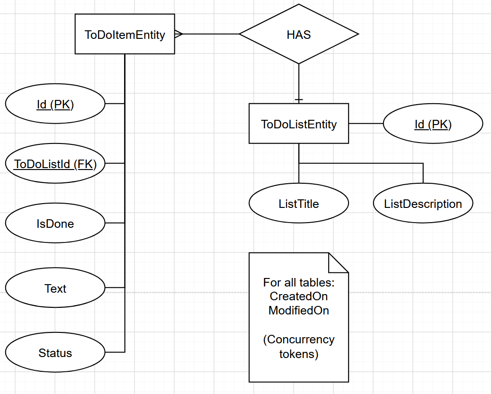
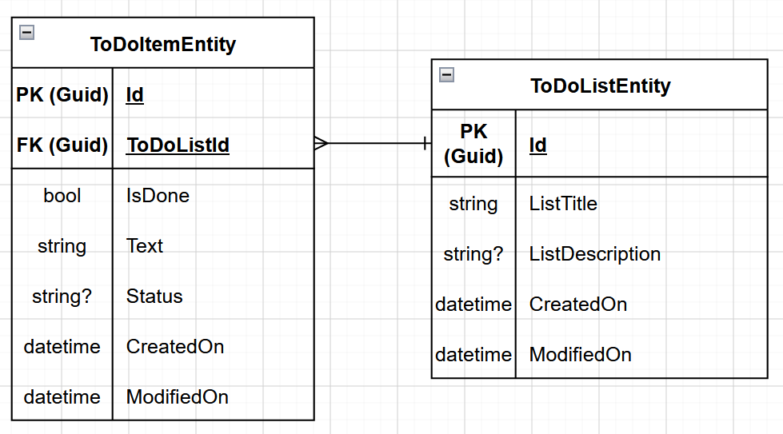
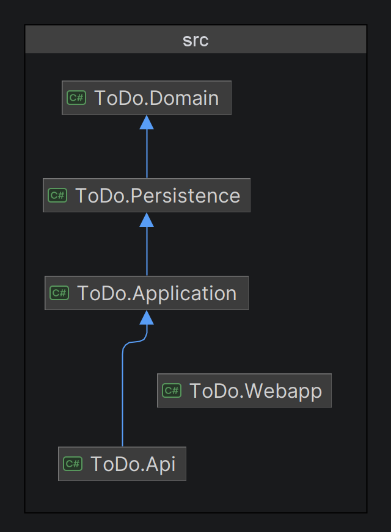

# ToDo 
A simple ToDo webapp. <br>
The main purpose of this project is to learn to work together as a group, hence the very simple task of making a ToDo app. 

## Usage

1. Make sure docker and wsl is installed. (pc might need a restart before point 2)
    ```pwsh
    wsl.exe --install
    ```
    [Docker Desktop](https://www.docker.com/products/docker-desktop/)
2. Clone or download this project. And unzip if downloaded.
3. Make sure Docker is running.
4. Open terminal in the project folder or cd into it.
5. Run the following command:
   ```
   docker compose run -d
   ```
6. The API container sometimes shuts down because it tries to connect to the database too early and might need to be started up manually.
7. The API's address is http://localhost:5295/swagger and the blazor frontend is located at http://localhost:5038.

## Requirements

- [x] Single user application.
- [x] Be able to create ToDo lists.
- [x] Be able to view an overview of all lists.
- [x] Be able to view a specific ToDo list and its ToDo items.
- [x] Be able to update a ToDo list's title and description.
- [x] Be able to delete a ToDo list along with its ToDo items.
  - [x] Prompt user if they're sure when they want to delete a ToDo list.
- [x] Be able to create ToDo items to a ToDo list.
- [x] Be able to update a ToDo item's text, status, or whether it's done or not.
- [x] Be able to delete a ToDo item from a ToDo list.
  - [x] The user should not be prompted when deleting a ToDo item.
     
## Documentation

### Entity Relation Diagram



### Enhanced Entity Relation Diagram



### Dependency Diagram


